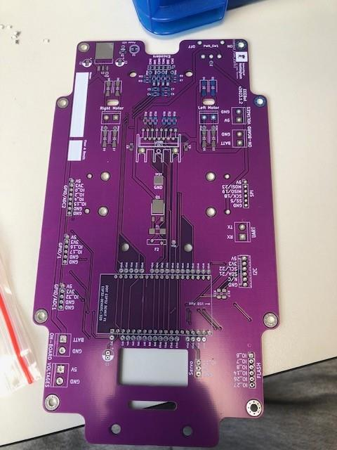
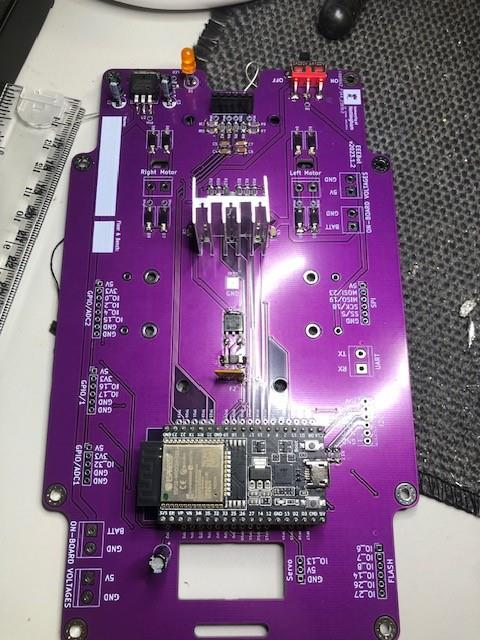
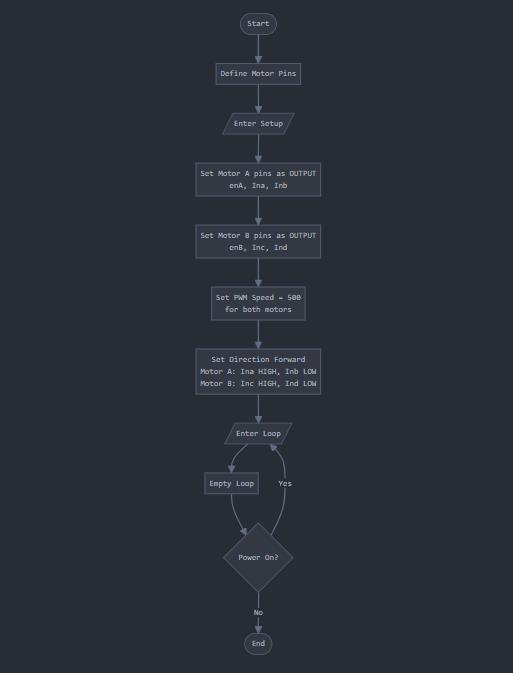
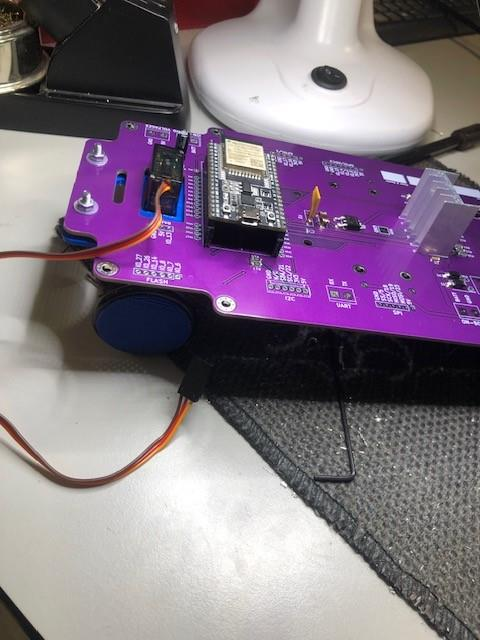
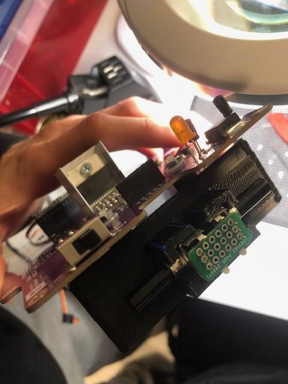
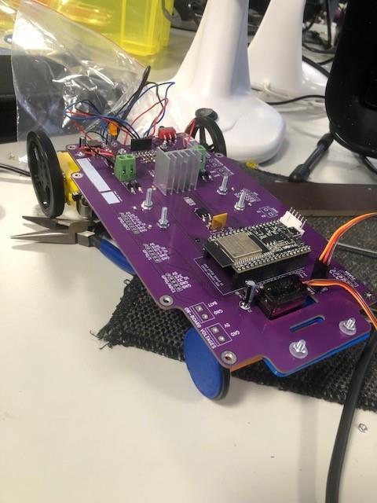
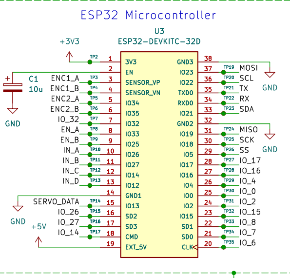

# EEEbot Robot Construction — Documentation

This folder contains the original photographs, ESP32 pinout and motor-control flowchart from the EEEbot construction and testing project.

The images document the assembly of the robot, from PCB soldering and chassis construction to the completed vehicle.

## PCB Assembly

### Surface-Mount Components

Surface-mount components installed on the EEEbot printed circuit board.

### Through-Hole Components

Through-hole components installed during PCB construction.

## Motor Control Flowchart

Flowchart illustrating the basic motor-control program used to drive the EEEbot.

## Chassis Construction

### Front Chassis Assembly

Assembly of the front chassis, including the steering servo and mechanical components.

### Rear Chassis and Encoder

Rear chassis assembly showing the motor and encoder integration.

## Completed EEEbot

The assembled robotic vehicle with its mechanical and electronic components integrated.

## ESP32 Pinout

ESP32 pinout reference used during programming and hardware integration.

## Additional Information

For the Arduino code, hardware overview, construction process, results and limitations, see the [main README](../README.md).
